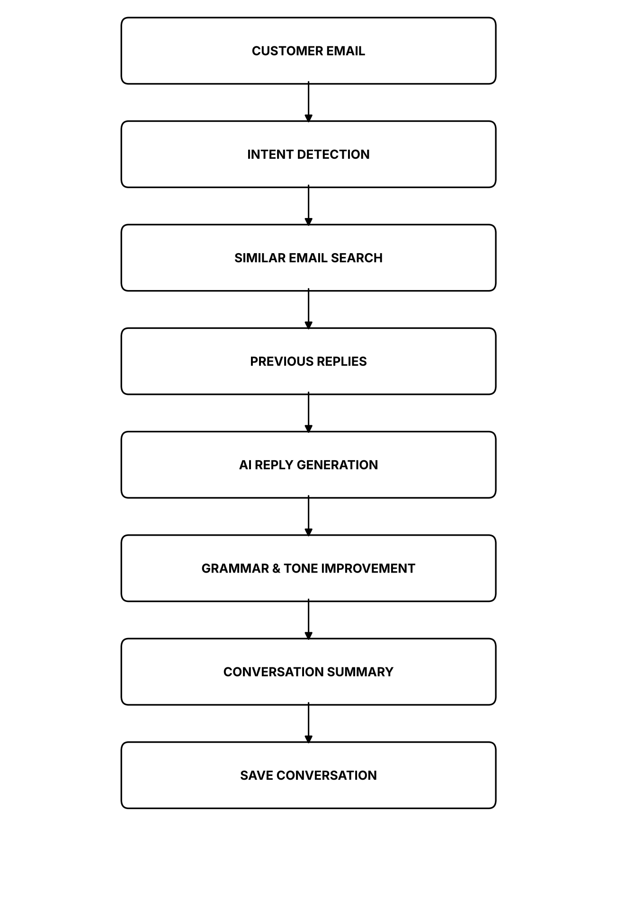
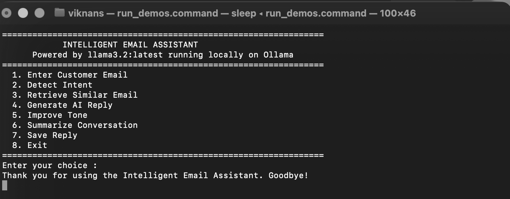
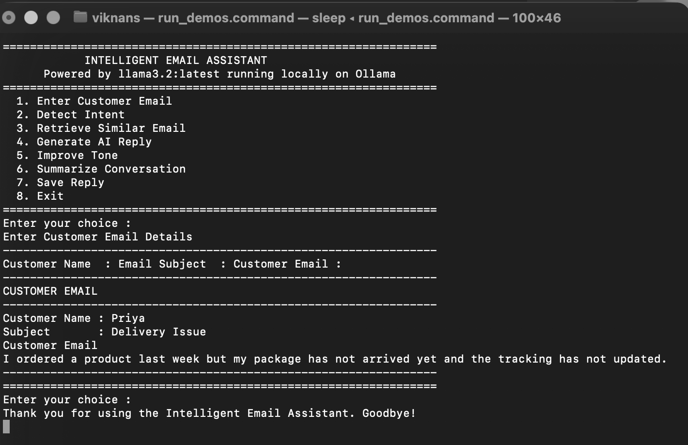
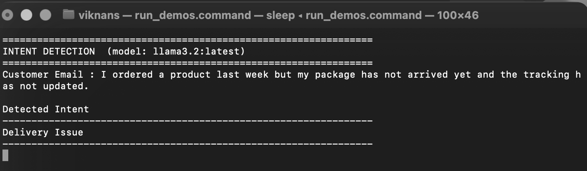
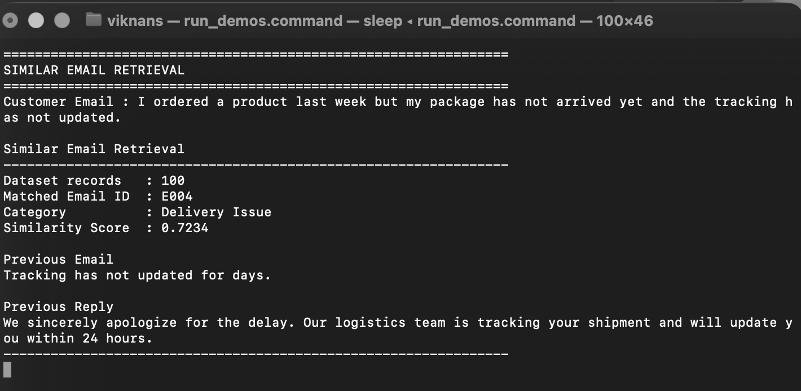
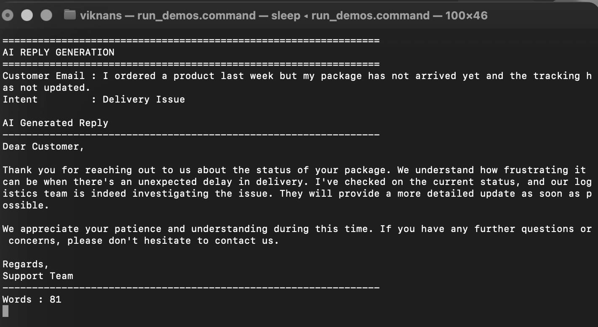
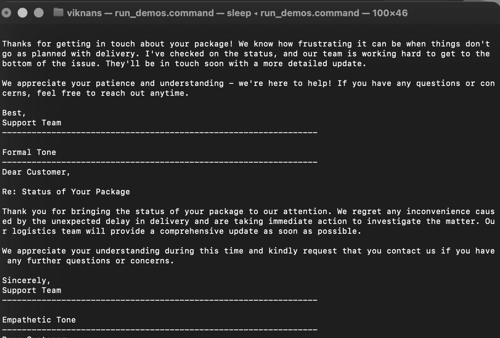
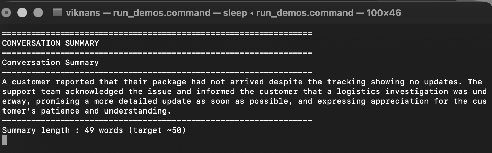
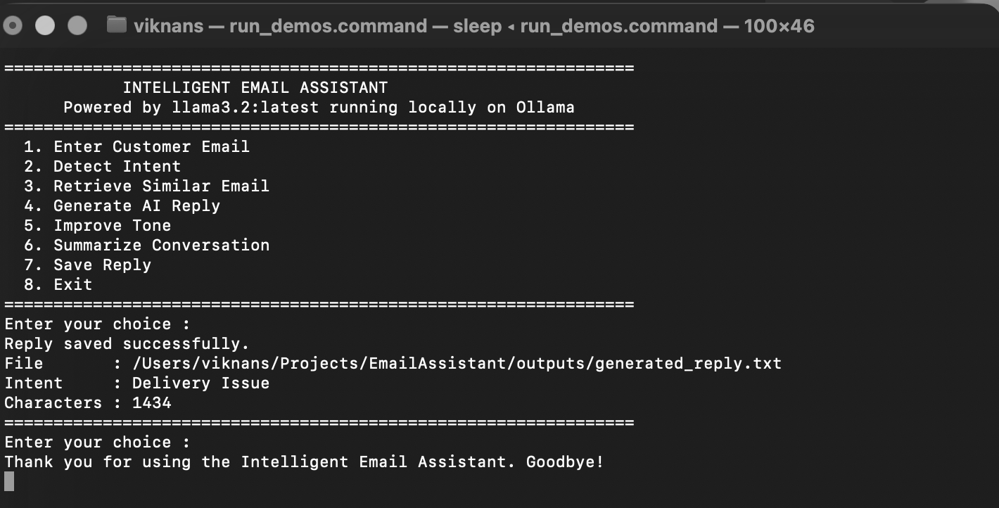

# Intelligent Email Assistant

Experiment 3 of **24CS2506 - Building Applications using GPT-4**.

An AI-powered email assistant that runs entirely on a local machine using
**Llama 3.2** served by **Ollama**. It reads a customer email, classifies the
intent, retrieves the most similar historical conversation from a 100-record
dataset using Sentence Transformer embeddings, generates a professional reply,
rewrites it in friendly, formal and empathetic tones, summarises the
conversation and saves everything to a file.

## Setup

```bash
ollama pull llama3.2
ollama serve

python3 -m venv .venv && source .venv/bin/activate
pip install -r requirements.txt
```

## Run

```bash
python main.py
```

## Modules

| File | Responsibility |
|------|----------------|
| `input_module.py` | Collects and displays the customer name, subject and email |
| `intent_module.py` | Classifies the email into one of the dataset categories |
| `retrieval_module.py` | Embeds the dataset and retrieves the most similar previous email and reply |
| `reply_module.py` | Generates a professional reply from the email, intent and previous reply |
| `tone_module.py` | Rewrites the reply in friendly, formal and empathetic tones |
| `summary_module.py` | Summarises the conversation in about 50 words |
| `utils.py` | Ollama client, dataset loading, session state and saving the reply |
| `main.py` | Menu driven application with continuous interaction |

## Dataset

`data/emails.csv` — 100 previous customer interactions with the columns
Email_ID, Customer_Name, Email_Date, Category, Priority, Subject,
Customer_Email, Intent, Sentiment, Previous_Reply, Status and Agent_Name.

## System architecture



## Output screenshots

| | |
|---|---|
| Home screen |  |
| Customer email |  |
| Intent detection |  |
| Similar email retrieval |  |
| AI reply |  |
| Tone improvement |  |
| Conversation summary |  |
| Saved reply |  |
